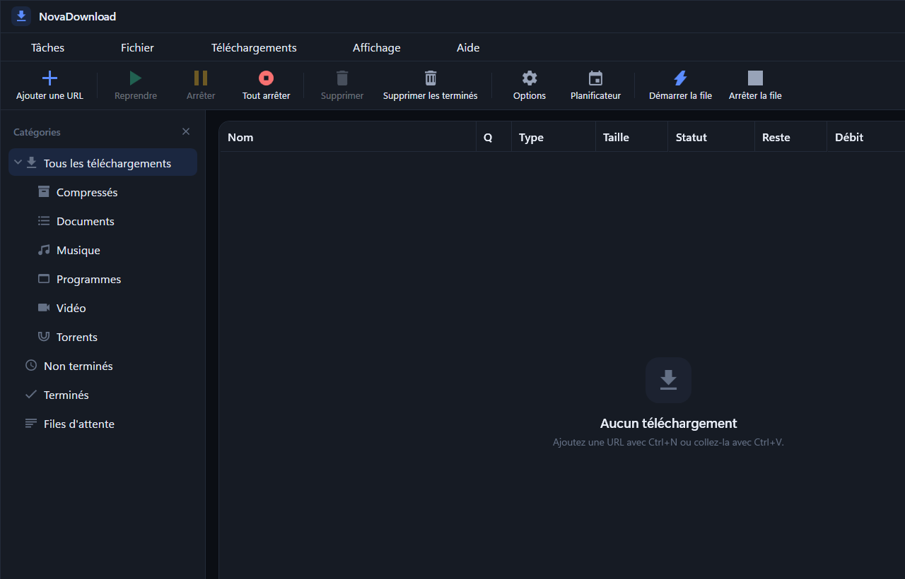
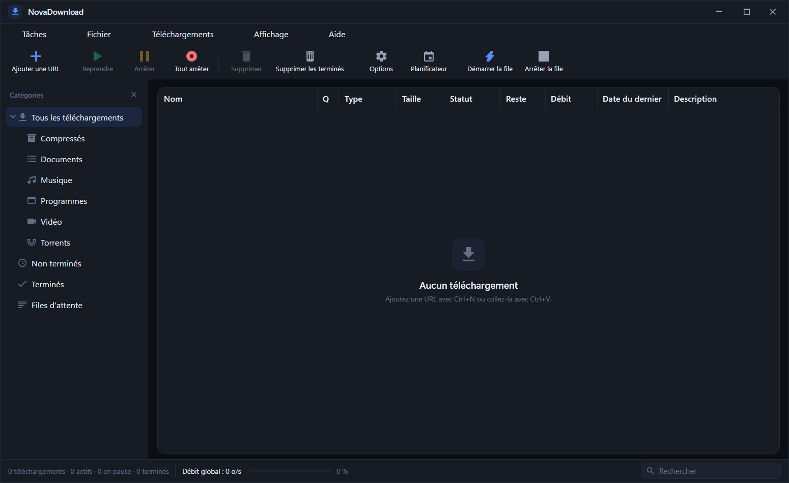
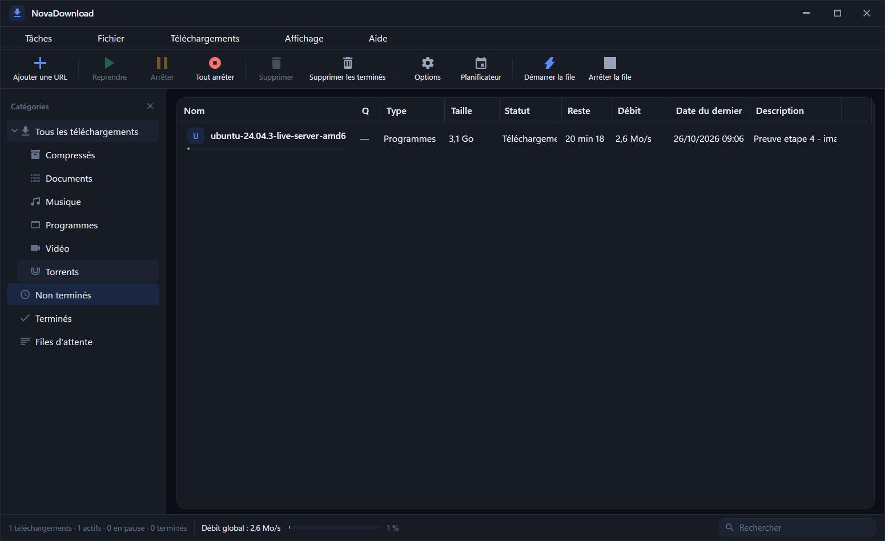

# Mdownloader

**Mdownloader** is a multi‑file torrent and HTTP downloader for Windows. It lets you paste a magnet link or `.torrent` file, choose exactly which files you want from a multi‑file torrent, then download only those files from the swarm. It also supports standard HTTP/HTTPS downloads, plus pause/resume/cancel, queue monitoring, configurable engine limits, and Windows magnet-link integration.

GitHub description you can paste into **About**:

> Multi‑file torrent & HTTP downloader with per‑file selection, magnet links, and live swarm telemetry

- Downloading torrent and magnet links.
- Selecting specific files within multi‑file torrents.
- Resuming, pausing, canceling, and monitoring downloads.
- Configurable HTTP download options.
- Built‑in integration with Windows URL‑protocol handlers.

## Build & Run

1. Install the .NET 9 SDK (or later). 
2. `dotnet build` to compile the project. 
3. `dotnet run --project src/NovaDownload.App` to launch the UI or use the CLI.

## Contribute

Feel free to open issues or submit pull requests. Code is under the MIT license.

---

## Binaries

A prebuilt Windows x64 executable is available at:

- [`dist/NovaDownload-1.0.0-win-x64.exe`](dist/NovaDownload-1.0.0-win-x64.exe)

This executable is framework-dependent and requires **.NET 9 Desktop Runtime (x64)**.

See [`dist/README.md`](dist/README.md) for run instructions.

View the full docs under `docs/`.

## Screenshots

---
